# GraphTopic: A Graph-based Approach for Topic Modeling

GraphTopic is a topic model that builds topics from **keyphrases** instead of word distributions. It extracts keyphrases with KeyBERT, links them in a graph while it reads the documents one by one, and then **recursively merges** subtopics whose sentence-embedding distributions overlap. The result is a small set of topics made of multi-word phrases (bigrams and trigrams).

This repository contains:

* the `GraphTopic` Python package (the model);
* the **full experiment code** used for the revised manuscript: 7 datasets, 9 baselines, Optuna hyperparameter tuning, and the projection check;
* **all results**: per-chunk and averaged scores, every Optuna trial, the hyperparameter-effect analysis, the scalability study, and all figures.

> Paper: *GraphTopic: A Graph-based Approach for Topic Modeling*, submitted to IEEE Transactions on Emerging Topics in Computational Intelligence (under revision). The citation will be added on acceptance.

---

## Contents

- [1. How GraphTopic works](#1-how-graphtopic-works)
- [2. Repository layout](#2-repository-layout)
- [3. Installation](#3-installation)
- [4. Using the package](#4-using-the-package)
- [5. Reproducing the experiments](#5-reproducing-the-experiments)
- [6. Experimental setup](#6-experimental-setup)
- [7. Results: comparison with nine baselines](#7-results-comparison-with-nine-baselines)
- [8. Hyperparameter tuning and parameter effects](#8-hyperparameter-tuning-and-parameter-effects)
- [9. Scalability analysis](#9-scalability-analysis)
- [10. Projection check (1-D overlap ω)](#10-projection-check-1-d-overlap-ω)
- [11. Limitations and notes](#11-limitations-and-notes)
- [12. Contributing](#12-contributing)

---

## 1. How GraphTopic works

| Step | What happens | Main parameter |
|---|---|---|
| 1. Keyphrase extraction | KeyBERT extracts 2–3-gram keyphrases from the merged corpus and from every document. | – |
| 2. Trivial topics | The top-$N$ keyphrases of the merged corpus each start a "trivial" topic. | $N$ = `TopM` |
| 3. Latent topics | Each document's top-$\eta$ keyphrases connect the trivial topics they hit, which builds a directed graph. Each weakly connected subgraph is a latent topic. Topics with fewer than `prune_node_count_less_than` keyphrases are pruned. | $\eta$ = `TopN` |
| 4. Recursive merging | Keyphrases are embedded with `all-mpnet-base-v2` and reduced with PCA. For every pair of subtopics, both are projected onto the line through their centres, and a Gaussian is fitted to each. The overlap $\omega$ of the two Gaussians is computed, and the pair is merged if $\omega \ge \theta$. This repeats until no pair can be merged. | $\theta$ = `overlapping_threshold` |
| 5. Topic output | For each final topic, the keyphrases closest to the topic centroid (`CDIST`) are returned, or the most central graph nodes (`IMP_NODE`). | `max_topics`, `max_keyphrases_per_topic` |

## 2. Repository layout

```
GraphTopic/
├── GraphTopic/                    # the package (model code)
│   ├── main.py                    #   class GraphTopic
│   ├── helpers/                   #   keyphrase extraction, topic extraction & merging, config
│   └── utils/
├── data/                          # sample data + prepare.py (used by runner.py / test-runner.py)
├── others/, scores/               # baselines and scores of the first (v0) evaluation
├── runner.py                      # minimal example
├── test-runner.py                 # first (v0) evaluation: 3 datasets, 5 baselines (legacy)
│
├── experiments/                   # >>> code of the revised-manuscript experiments
│   ├── full_dataset_comparison_v1.py   # main script: 7 datasets x 10 models, Optuna tuning, plots
│   ├── baseline/baseline_models.py     # LDA, NMF, HDP, LSI (Gensim), BERTopic, TopMost models
│   ├── scores/                         # metric helpers (v1 metrics are inlined in the main script)
│   ├── projection_check.py             # checks the 1-D overlap omega against full-space measures
│   ├── visualize_projections_standalone.py
│   ├── check_coherence_equivalence.py  # verifies the memory fix leaves coherence unchanged
│   ├── FIXES_NOTE.md                   # fixes applied during the runs (read before re-running)
│   ├── tweets_01-08-2021.csv           # Trump tweets used in the experiments
│   └── requirements.txt
│
└── results/                       # >>> all outputs used in the manuscript and response letter
    ├── full_comparison_v1/        # scores of all models on all datasets + Optuna studies + figures
    ├── parameter_effects/         # analysis of the hyperparameters (592 completed trials)
    ├── scalability/               # runtime vs corpus size (10 models x 3 datasets x 10 sizes)
    └── projection_check/          # omega vs 3-D / 768-D overlap measures
```

The result folders are described file by file in [`results/README.md`](results/README.md).

## 3. Installation

```bash
git clone https://github.com/dev-SR/GraphTopic.git
cd GraphTopic
python -m venv venv
# Windows: venv\Scripts\activate      macOS/Linux: source venv/bin/activate
pip install -r requirements.txt
python -m spacy download en_core_web_sm
python -c "import nltk; [nltk.download(r) for r in ['stopwords','punkt','punkt_tab','averaged_perceptron_tagger','averaged_perceptron_tagger_eng']]"
```

For the experiments, also install `pip install -r experiments/requirements.txt`. The experiments used Python 3.11/3.12. A CUDA GPU is optional; it speeds up the embeddings and the neural baselines.

## 4. Using the package

```python
from GraphTopic import GraphTopic

documents = [
    "Machine learning is a field of artificial intelligence that focuses on building models ...",
    "Deep learning is a subset of machine learning that uses neural networks ...",
    "Graph neural networks are used for analyzing graph-structured data ...",
]

model = GraphTopic(
    docs=documents,
    TopM=1000,                  # N: keyphrases from the merged corpus (trivial topics)
    TopN=15,                    # eta: keyphrases per document
    overlapping_threshold=0.5,  # theta: merge two subtopics if their overlap >= theta
    max_topics=10,
    max_keyphrases_per_topic=10,
)
print(model.get_topics())       # list of topics, each a list of keyphrases
```

Run the bundled example with `python runner.py`.

### Parameters of `GraphTopic(...)`

| Parameter | Default | Description |
|---|---|---|
| `docs` | – | List of document strings. |
| `TopM` ($N$) | `500` | Number of keyphrases taken from the merged corpus; each starts a trivial topic. Larger values give finer initial topics. |
| `TopN` ($\eta$) | `10` | Number of keyphrases taken from each document; they link the trivial topics into latent topics. |
| `overlapping_threshold` ($\theta$) | `0.5` | Minimum overlap $\omega$ of two subtopics for them to be merged. Higher values merge less and keep more, distinct topics. |
| `keyphrase_extractor` | KeyBERT | Any function `f(text, n) -> [(phrase, weight), ...]`. |
| `embedding_model` | `all-mpnet-base-v2` | SentenceTransformer used to embed keyphrases. |
| `prune_node_count_less_than` | `2` | Latent topics with fewer keyphrases than this are removed. |
| `max_topics` | `inf` | Maximum number of returned topics. |
| `max_keyphrases_per_topic` | `100` | Maximum keyphrases per returned topic. |
| `keyphrases_selection_strategy` | `CDIST` | `CDIST` (closest to the topic centroid), `IMP_NODE` (highest out-degree in the topic graph), or `RNDOM`. |
| `pretty_print` | `False` | Prints the intermediate merge steps. |

**Recommended defaults.** In our analysis of 592 tuning trials (Section 8), $(N, \eta, \theta) = (1000, 15, 0.50)$ was a robust default. If you cannot tune, start there. If you can, try $\theta = 0.35$ first: a lower $\theta$ gave higher scores on all seven datasets.

## 5. Reproducing the experiments

```bash
cd experiments
python full_dataset_comparison_v1.py --smoke        # wiring check: 80-doc chunks, 1 chunk/dataset, 2 trials
python full_dataset_comparison_v1.py                # full run (all datasets, all models, Optuna)
python full_dataset_comparison_v1.py --force-rerun  # ignore all caches
python projection_check.py                          # projection check (after the full run)
```

* The six public datasets are downloaded from the Hugging Face Hub. The Trump tweets are read from `experiments/tweets_01-08-2021.csv`.
* Outputs go to `experiments/hyperparameter_analysis_results/full_comparison_v1/`.
* The script **caches** every chunk result and every Optuna study, and resumes where it stopped. To reuse our results instead of recomputing them, copy `results/full_comparison_v1/` to `experiments/hyperparameter_analysis_results/full_comparison_v1/` first. The cache is keyed on a hash of the configuration, so any change to the settings triggers a re-run.
* The script contains a self-contained copy of the GraphTopic algorithm and the evaluation metrics. A run therefore does not depend on later edits to the package.
* Read [`experiments/FIXES_NOTE.md`](experiments/FIXES_NOTE.md) before you re-run. It lists the fixes applied during our runs: memory use on NIPS, TopMost GPU device placement, the FASTopic vocabulary, and the retrying of failed chunks.
* **Not included:** the scripts that produced `results/scalability/` and `results/parameter_effects/` are not in this repository; only their outputs are. The settings used are documented in Sections 8 and 9.

Full runs are long. GraphTopic tuning alone took 94.9 h of compute over 30 chunks (Section 8).

## 6. Experimental setup

### Datasets

Each corpus is split into contiguous chunks of equal size, and every model is run on every chunk. The tables report the **mean ± standard deviation over chunks**. 20NG, BBC, and Trump use the chunk sizes of the original study; the other datasets are split into five equal chunks.

| Dataset | Hugging Face / source | Documents | Mean length (words) | Median length | Vocabulary | Docs per chunk | Chunks evaluated |
|---|---|---:|---:|---:|---:|---:|---:|
| 20NG | `SetFit/20_newsgroups` | 18,331 | 186.7 | 86 | 86,887 | 3,768 | 4 |
| BBC | `SetFit/bbc-news` | 2,225 | 390.3 | 337 | 27,851 | 2,225 | 1 |
| Trump | `tweets_01-08-2021.csv` | 56,571 | 19.6 | 19 | 38,381 | 11,314 | 5 |
| IMDB | `SetFit/imdb` | 50,000 | 231.2 | 173 | 99,084 | 10,000 | 5 |
| PubMed | `ronitHF/pubmed-10k` | 11,739 | 3115.8 | 2608 | 200,303 | 2,347 | 5 |
| RTL-Wiki | `TopicNet/RTL-Wiki` | 7,838 | 2751.5 | 1876 | 330,957 | 1,567 | 5 |
| NIPS | `TopicNet/NIPS` | 7,239 | 4850.7 | 5103 | 170,844 | 1,447 | 5 |

For 20NG, 4 of the 5 chunk slots hold a full 3,768-document chunk; the remaining documents are dropped, as in the original study. BBC has 2,225 documents and therefore forms a single chunk.

### Models

| Group | Models | Implementation |
|---|---|---|
| Classical | LDA, NMF, HDP, LSI | Gensim |
| Embedding clustering | BERTopic | authors' package |
| Neural topic models | ProdLDA (2017), HyperMiner (2022), ECRTM (2023), FASTopic (2024) | TopMost toolkit |
| Proposed | **GraphTopic** | this repository |

All baselines use their default settings with **10 topics**, 10 words per topic, a vocabulary of at most 3,000 features, and the $n$-gram range set to **(2, 3)** to match GraphTopic's keyphrases. The neural models train for 100 epochs. GraphTopic returns at most 10 topics of 10 keyphrases. Embeddings come from `sentence-transformers/all-mpnet-base-v2`. Seed: 42.

### Metrics

| Metric | Meaning | Better |
|---|---|---|
| $C_{NPMI}$ | Normalized pointwise mutual information of the topic words (main metric) | higher |
| $C_{UCI}$ | PMI-based coherence | higher |
| $C_V$ | Sliding-window, cosine-based coherence | higher |
| $U_{Mass}$ | Document co-occurrence coherence | higher (closer to 0) |
| Intra-topic similarity | Mean embedding similarity of the words within a topic | higher |
| Inter-topic distance | Mean embedding distance between topics | higher |
| Semantic coherence | Mean of the intra-topic similarity and the inter-topic distance | higher |

## 7. Results: comparison with nine baselines

All values come from [`results/full_comparison_v1/global_comparison_summary.csv`](results/full_comparison_v1/global_comparison_summary.csv). They are the mean ± standard deviation over chunks; BBC has one chunk and so no standard deviation. The best value in each column is in **bold**.

### Summary

| Metric | GraphTopic best on | Datasets where another model is best |
|---|:---:|---|
| C_NPMI | 6/7 | IMDB (LSI) |
| C_UCI | 6/7 | IMDB (LSI) |
| C_V | 4/7 | IMDB (LSI), RTL-Wiki (HyperMiner), NIPS (LDA) |
| U_Mass | 5/7 | IMDB (LSI), NIPS (LDA) |
| Intra-topic similarity | 7/7 | — |
| Inter-topic distance | 0/7 | 20NG (ProdLDA), BBC (ECRTM), Trump (BERTopic), IMDB (BERTopic), PubMed (ECRTM), RTL-Wiki (ECRTM), NIPS (ECRTM) |
| Semantic coherence | 6/7 | PubMed (ECRTM) |

GraphTopic has the highest $C_{NPMI}$ and $C_{UCI}$ on six of the seven datasets and the highest intra-topic similarity on all seven. In $C_{NPMI}$ it beats FASTopic and ECRTM on every dataset. It does **not** win everywhere: LSI is better on IMDB, and GraphTopic has the lowest inter-topic distance on most datasets. Its topics are internally tight but closer to each other.

### $C_{NPMI}$ (main metric)

| Model | 20NG | BBC | Trump | IMDB | PubMed | RTL-Wiki | NIPS |
|---|---:|---:|---:|---:|---:|---:|---:|
| LDA | -0.193 ± 0.018 | -0.130 | -0.312 ± 0.087 | 0.176 ± 0.029 | -0.035 ± 0.033 | -0.045 ± 0.021 | -0.218 ± 0.035 |
| NMF | -0.166 ± 0.035 | -0.217 | -0.052 ± 0.082 | 0.267 ± 0.042 | -0.063 ± 0.062 | -0.109 ± 0.034 | -0.250 ± 0.043 |
| HDP | -0.285 ± 0.015 | -0.332 | -0.400 ± 0.008 | -0.182 ± 0.042 | -0.027 ± 0.047 | -0.117 ± 0.016 | -0.214 ± 0.078 |
| LSI | -0.107 ± 0.031 | 0.145 | 0.119 ± 0.080 | **0.297 ± 0.036** | -0.081 ± 0.016 | -0.033 ± 0.039 | -0.243 ± 0.038 |
| ProdLDA | -0.126 ± 0.066 | 0.028 | -0.198 ± 0.074 | -0.280 ± 0.017 | -0.091 ± 0.032 | -0.091 ± 0.039 | -0.171 ± 0.032 |
| HyperMiner | -0.083 ± 0.128 | 0.066 | -0.350 ± 0.019 | -0.033 ± 0.072 | -0.224 ± 0.022 | -0.104 ± 0.086 | -0.234 ± 0.080 |
| BERTopic | -0.100 ± 0.004 | 0.029 | -0.207 ± 0.114 | -0.081 ± 0.026 | -0.093 ± 0.022 | -0.156 ± 0.021 | -0.249 ± 0.017 |
| ECRTM | -0.222 ± 0.052 | -0.124 | -0.390 ± 0.014 | -0.294 ± 0.004 | -0.119 ± 0.032 | -0.104 ± 0.019 | -0.165 ± 0.023 |
| FASTopic | -0.120 ± 0.031 | -0.077 | -0.409 ± 0.050 | -0.189 ± 0.036 | -0.119 ± 0.022 | -0.157 ± 0.014 | -0.239 ± 0.023 |
| **GraphTopic (proposed)** | **0.594 ± 0.118** | **0.205** | **0.568 ± 0.118** | 0.211 ± 0.038 | **0.073 ± 0.102** | **0.306 ± 0.317** | **-0.063 ± 0.024** |

### $C_{UCI}$

| Model | 20NG | BBC | Trump | IMDB | PubMed | RTL-Wiki | NIPS |
|---|---:|---:|---:|---:|---:|---:|---:|
| LDA | -6.969 ± 0.196 | -6.091 | -10.579 ± 1.316 | 0.174 ± 0.569 | -3.766 ± 0.675 | -3.753 ± 0.393 | -7.676 ± 0.710 |
| NMF | -6.412 ± 0.545 | -7.547 | -6.665 ± 1.300 | 1.688 ± 0.751 | -4.073 ± 1.074 | -4.704 ± 0.667 | -8.204 ± 0.791 |
| HDP | -8.099 ± 0.267 | -9.250 | -11.089 ± 0.214 | -6.290 ± 0.798 | -3.628 ± 0.815 | -5.038 ± 0.314 | -7.455 ± 1.573 |
| LSI | -5.376 ± 0.504 | -1.421 | -3.705 ± 1.075 | **1.805 ± 0.662** | -4.269 ± 0.268 | -3.467 ± 0.638 | -8.140 ± 0.695 |
| ProdLDA | -5.692 ± 0.940 | -3.427 | -7.960 ± 1.050 | -8.111 ± 0.325 | -4.640 ± 0.497 | -4.165 ± 0.641 | -6.471 ± 0.611 |
| HyperMiner | -5.237 ± 1.903 | -2.606 | -11.176 ± 0.873 | -3.612 ± 1.280 | -6.910 ± 0.385 | -5.059 ± 1.442 | -7.536 ± 1.246 |
| BERTopic | -5.277 ± 0.015 | -3.227 | -8.059 ± 1.984 | -4.486 ± 0.496 | -4.595 ± 0.380 | -5.348 ± 0.323 | -7.796 ± 0.352 |
| ECRTM | -7.042 ± 0.736 | -5.740 | -11.031 ± 0.260 | -8.526 ± 0.070 | -4.602 ± 0.596 | -3.749 ± 0.377 | -6.298 ± 0.392 |
| FASTopic | -5.691 ± 0.352 | -4.891 | -12.138 ± 1.254 | -6.721 ± 0.700 | -5.072 ± 0.354 | -5.182 ± 0.249 | -7.658 ± 0.320 |
| **GraphTopic (proposed)** | **5.612 ± 1.820** | **-0.179** | **3.861 ± 1.614** | 0.495 ± 0.594 | **-1.450 ± 1.750** | **2.564 ± 4.255** | **-3.386 ± 0.345** |

### $C_V$

| Model | 20NG | BBC | Trump | IMDB | PubMed | RTL-Wiki | NIPS |
|---|---:|---:|---:|---:|---:|---:|---:|
| LDA | 0.354 ± 0.022 | 0.393 | 0.491 ± 0.026 | 0.634 ± 0.037 | 0.654 ± 0.037 | 0.485 ± 0.039 | **0.640 ± 0.048** |
| NMF | 0.415 ± 0.048 | 0.429 | 0.431 ± 0.057 | 0.757 ± 0.041 | 0.500 ± 0.054 | 0.347 ± 0.020 | 0.551 ± 0.062 |
| HDP | 0.485 ± 0.011 | 0.540 | 0.560 ± 0.006 | 0.410 ± 0.026 | 0.684 ± 0.034 | 0.469 ± 0.021 | 0.579 ± 0.104 |
| LSI | 0.579 ± 0.064 | 0.770 | 0.473 ± 0.055 | **0.775 ± 0.028** | 0.490 ± 0.063 | 0.514 ± 0.066 | 0.500 ± 0.056 |
| ProdLDA | 0.394 ± 0.048 | 0.566 | 0.480 ± 0.032 | 0.470 ± 0.017 | 0.600 ± 0.050 | 0.437 ± 0.031 | 0.533 ± 0.059 |
| HyperMiner | 0.522 ± 0.122 | 0.629 | 0.290 ± 0.076 | 0.523 ± 0.041 | 0.416 ± 0.076 | **0.847 ± 0.212** | 0.571 ± 0.190 |
| BERTopic | 0.377 ± 0.084 | 0.461 | 0.387 ± 0.001 | 0.436 ± 0.074 | 0.588 ± 0.033 | 0.372 ± 0.040 | 0.434 ± 0.042 |
| ECRTM | 0.433 ± 0.041 | 0.463 | 0.534 ± 0.023 | 0.444 ± 0.020 | 0.449 ± 0.049 | 0.290 ± 0.039 | 0.534 ± 0.054 |
| FASTopic | 0.365 ± 0.019 | 0.377 | 0.548 ± 0.028 | 0.427 ± 0.040 | 0.577 ± 0.031 | 0.336 ± 0.030 | 0.455 ± 0.039 |
| **GraphTopic (proposed)** | **0.924 ± 0.075** | **0.924** | **0.804 ± 0.071** | 0.731 ± 0.059 | **0.859 ± 0.152** | 0.777 ± 0.144 | 0.432 ± 0.051 |

### $U_{Mass}$

| Model | 20NG | BBC | Trump | IMDB | PubMed | RTL-Wiki | NIPS |
|---|---:|---:|---:|---:|---:|---:|---:|
| LDA | -15.260 ± 1.528 | -15.485 | -18.278 ± 1.195 | -6.991 ± 0.713 | -6.330 ± 1.089 | -11.078 ± 0.917 | **-2.148 ± 0.377** |
| NMF | -7.003 ± 1.816 | -15.386 | -14.078 ± 1.290 | -5.059 ± 0.694 | -8.238 ± 0.595 | -13.477 ± 1.705 | -3.762 ± 0.661 |
| HDP | -18.102 ± 0.789 | -21.028 | -19.842 ± 0.138 | -15.329 ± 1.026 | -5.130 ± 0.743 | -9.025 ± 1.025 | -3.511 ± 1.004 |
| LSI | -1.764 ± 0.819 | -3.603 | -10.537 ± 1.257 | **-4.403 ± 0.566** | -6.052 ± 0.970 | -4.613 ± 1.519 | -2.739 ± 0.605 |
| ProdLDA | -8.666 ± 0.987 | -8.812 | -16.620 ± 1.225 | -19.546 ± 0.294 | -7.038 ± 1.164 | -11.692 ± 0.970 | -3.569 ± 0.417 |
| HyperMiner | -3.956 ± 3.898 | -8.375 | -18.524 ± 0.481 | -10.934 ± 1.578 | -7.688 ± 1.459 | -3.184 ± 4.648 | -5.325 ± 3.638 |
| BERTopic | -14.963 ± 0.246 | -10.581 | -16.295 ± 1.982 | -12.855 ± 0.714 | -7.195 ± 1.128 | -12.611 ± 1.193 | -5.677 ± 0.894 |
| ECRTM | -15.946 ± 2.874 | -14.481 | -19.710 ± 0.212 | -19.308 ± 0.226 | -8.630 ± 0.592 | -11.420 ± 1.212 | -2.873 ± 0.682 |
| FASTopic | -15.176 ± 0.906 | -13.461 | -19.456 ± 0.886 | -16.595 ± 0.538 | -8.488 ± 0.653 | -14.910 ± 0.791 | -3.583 ± 0.651 |
| **GraphTopic (proposed)** | **-1.726 ± 1.687** | **-2.035** | **-5.150 ± 1.847** | -6.627 ± 1.865 | **-0.946 ± 0.592** | **-0.585 ± 0.415** | -5.584 ± 2.286 |

### Intra-topic similarity

| Model | 20NG | BBC | Trump | IMDB | PubMed | RTL-Wiki | NIPS |
|---|---:|---:|---:|---:|---:|---:|---:|
| LDA | 0.275 ± 0.004 | 0.312 | 0.350 ± 0.026 | 0.484 ± 0.006 | 0.355 ± 0.023 | 0.306 ± 0.007 | 0.312 ± 0.014 |
| NMF | 0.370 ± 0.019 | 0.291 | 0.422 ± 0.018 | 0.497 ± 0.025 | 0.365 ± 0.035 | 0.296 ± 0.010 | 0.295 ± 0.018 |
| HDP | 0.230 ± 0.014 | 0.223 | 0.263 ± 0.015 | 0.333 ± 0.009 | 0.349 ± 0.014 | 0.314 ± 0.009 | 0.303 ± 0.016 |
| LSI | 0.400 ± 0.019 | 0.390 | 0.515 ± 0.056 | 0.572 ± 0.014 | 0.402 ± 0.035 | 0.389 ± 0.009 | 0.323 ± 0.021 |
| ProdLDA | 0.348 ± 0.022 | 0.377 | 0.287 ± 0.009 | 0.315 ± 0.013 | 0.391 ± 0.019 | 0.351 ± 0.021 | 0.375 ± 0.017 |
| HyperMiner | 0.404 ± 0.033 | 0.422 | 0.375 ± 0.074 | 0.575 ± 0.071 | 0.342 ± 0.019 | 0.436 ± 0.053 | 0.380 ± 0.045 |
| BERTopic | 0.342 ± 0.057 | 0.338 | 0.357 ± 0.024 | 0.410 ± 0.020 | 0.338 ± 0.012 | 0.328 ± 0.016 | 0.321 ± 0.036 |
| ECRTM | 0.271 ± 0.053 | 0.311 | 0.272 ± 0.007 | 0.353 ± 0.017 | 0.396 ± 0.024 | 0.363 ± 0.029 | 0.390 ± 0.024 |
| FASTopic | 0.306 ± 0.013 | 0.347 | 0.344 ± 0.042 | 0.350 ± 0.010 | 0.353 ± 0.016 | 0.297 ± 0.022 | 0.354 ± 0.011 |
| **GraphTopic (proposed)** | **0.702 ± 0.020** | **0.782** | **0.784 ± 0.041** | **0.808 ± 0.020** | **0.865 ± 0.050** | **0.896 ± 0.050** | **0.751 ± 0.013** |

### Inter-topic distance

| Model | 20NG | BBC | Trump | IMDB | PubMed | RTL-Wiki | NIPS |
|---|---:|---:|---:|---:|---:|---:|---:|
| LDA | 0.874 ± 0.002 | 0.822 | 0.756 ± 0.036 | 0.662 ± 0.003 | 0.852 ± 0.012 | 0.831 ± 0.012 | 0.805 ± 0.011 |
| NMF | 0.849 ± 0.012 | 0.824 | 0.754 ± 0.021 | 0.620 ± 0.021 | 0.845 ± 0.016 | 0.834 ± 0.016 | 0.812 ± 0.010 |
| HDP | 0.877 ± 0.005 | 0.855 | 0.818 ± 0.011 | 0.739 ± 0.009 | 0.836 ± 0.020 | 0.826 ± 0.013 | 0.775 ± 0.027 |
| LSI | 0.875 ± 0.011 | 0.848 | 0.730 ± 0.034 | 0.513 ± 0.009 | 0.860 ± 0.008 | 0.824 ± 0.025 | 0.789 ± 0.013 |
| ProdLDA | **0.896 ± 0.010** | 0.858 | 0.844 ± 0.018 | 0.771 ± 0.016 | 0.875 ± 0.007 | 0.880 ± 0.003 | 0.853 ± 0.010 |
| HyperMiner | 0.863 ± 0.072 | 0.693 | 0.747 ± 0.138 | 0.531 ± 0.147 | 0.780 ± 0.081 | 0.598 ± 0.051 | 0.672 ± 0.046 |
| BERTopic | 0.863 ± 0.024 | 0.850 | **0.847 ± 0.000** | **0.771 ± 0.004** | 0.868 ± 0.011 | 0.842 ± 0.010 | 0.857 ± 0.008 |
| ECRTM | 0.882 ± 0.005 | **0.862** | 0.818 ± 0.016 | 0.725 ± 0.015 | **0.888 ± 0.009** | **0.882 ± 0.014** | **0.866 ± 0.009** |
| FASTopic | 0.879 ± 0.005 | 0.845 | 0.713 ± 0.045 | 0.738 ± 0.005 | 0.864 ± 0.009 | 0.863 ± 0.011 | 0.846 ± 0.011 |
| **GraphTopic (proposed)** | 0.727 ± 0.030 | 0.696 | 0.607 ± 0.068 | 0.558 ± 0.071 | 0.378 ± 0.331 | 0.575 ± 0.293 | 0.585 ± 0.037 |

### Semantic coherence

| Model | 20NG | BBC | Trump | IMDB | PubMed | RTL-Wiki | NIPS |
|---|---:|---:|---:|---:|---:|---:|---:|
| LDA | 0.574 ± 0.003 | 0.567 | 0.553 ± 0.008 | 0.573 ± 0.003 | 0.604 ± 0.012 | 0.569 ± 0.006 | 0.559 ± 0.005 |
| NMF | 0.610 ± 0.015 | 0.557 | 0.588 ± 0.010 | 0.558 ± 0.003 | 0.605 ± 0.016 | 0.565 ± 0.011 | 0.553 ± 0.008 |
| HDP | 0.553 ± 0.008 | 0.539 | 0.540 ± 0.005 | 0.536 ± 0.003 | 0.592 ± 0.016 | 0.570 ± 0.005 | 0.539 ± 0.009 |
| LSI | 0.638 ± 0.011 | 0.619 | 0.623 ± 0.019 | 0.543 ± 0.007 | 0.631 ± 0.017 | 0.607 ± 0.014 | 0.556 ± 0.006 |
| ProdLDA | 0.622 ± 0.006 | 0.618 | 0.565 ± 0.010 | 0.543 ± 0.003 | 0.633 ± 0.012 | 0.615 ± 0.012 | 0.614 ± 0.011 |
| HyperMiner | 0.634 ± 0.043 | 0.558 | 0.561 ± 0.043 | 0.553 ± 0.039 | 0.561 ± 0.034 | 0.517 ± 0.005 | 0.526 ± 0.009 |
| BERTopic | 0.602 ± 0.018 | 0.594 | 0.602 ± 0.012 | 0.590 ± 0.012 | 0.603 ± 0.010 | 0.585 ± 0.007 | 0.589 ± 0.017 |
| ECRTM | 0.577 ± 0.026 | 0.587 | 0.545 ± 0.005 | 0.539 ± 0.002 | **0.642 ± 0.013** | 0.623 ± 0.018 | 0.628 ± 0.015 |
| FASTopic | 0.593 ± 0.006 | 0.596 | 0.529 ± 0.004 | 0.544 ± 0.005 | 0.608 ± 0.005 | 0.580 ± 0.009 | 0.600 ± 0.004 |
| **GraphTopic (proposed)** | **0.715 ± 0.019** | **0.739** | **0.696 ± 0.016** | **0.683 ± 0.032** | 0.622 ± 0.152 | **0.736 ± 0.132** | **0.668 ± 0.024** |

### Figures

**Polar charts of all ten models on all seven datasets.** Each metric is min–max normalized across the models within a dataset. The last panel is the mean over datasets.

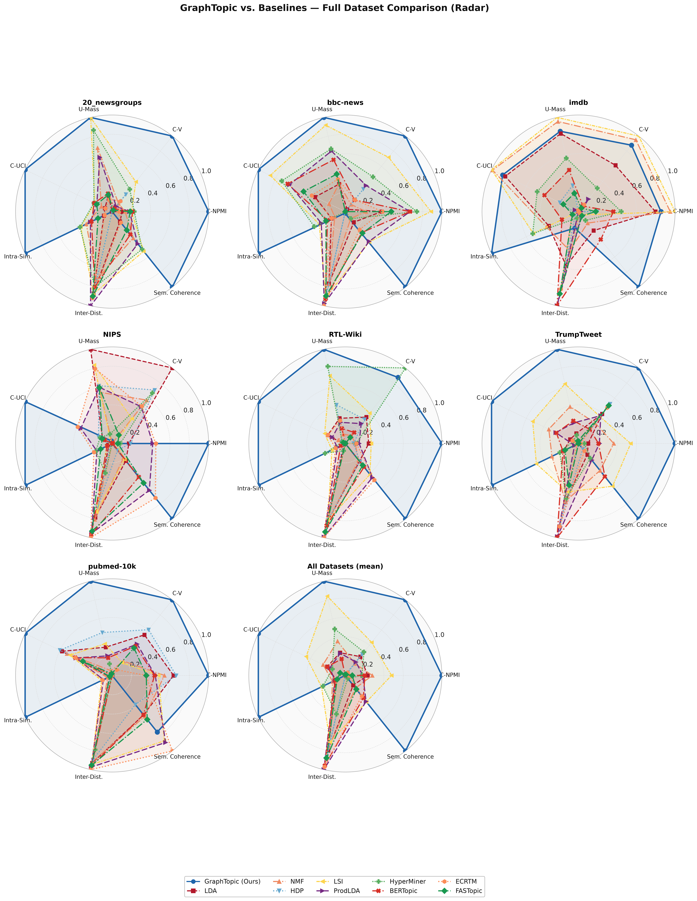

**Raw scores (bar charts)** of all models on all datasets:

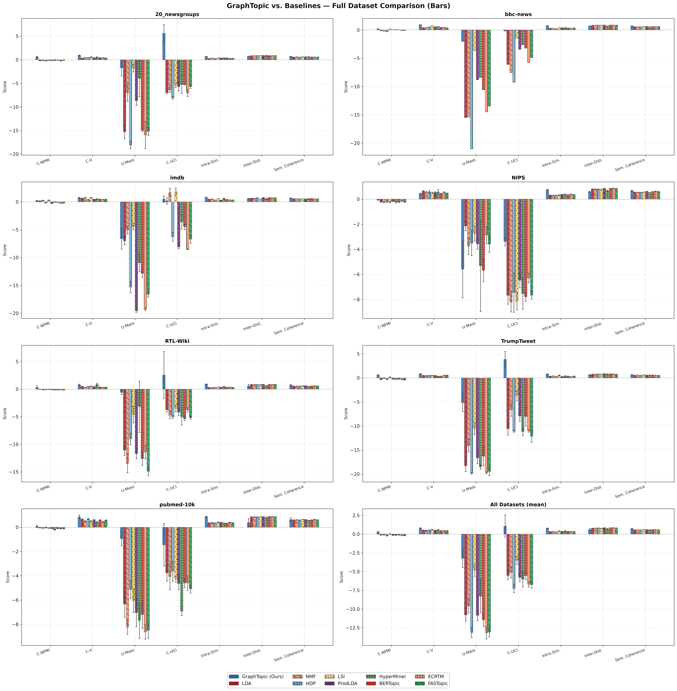

Per-dataset versions are in `results/full_comparison_v1/` as `spider_<dataset>.png` and `bars_<dataset>.png`.

### Runtime per chunk (seconds)

This is the wall time of one model run on one chunk, including scoring. For GraphTopic it is the run with the selected hyperparameters; tuning time is reported separately in Section 8.

| Model | 20NG | BBC | Trump | IMDB | PubMed | RTL-Wiki | NIPS | Mean |
|---|---:|---:|---:|---:|---:|---:|---:|---:|
| LDA | 31.7 | 35.9 | 19.0 | 33.0 | 146.9 | 115.7 | 103.1 | 69.3 |
| NMF | 27.2 | 30.4 | 10.3 | 17.2 | 132.8 | 109.3 | 73.6 | 57.3 |
| HDP | 27.6 | 31.2 | 13.5 | 20.4 | 137.2 | 107.8 | 64.6 | 57.5 |
| LSI | 28.0 | 37.4 | 11.6 | 16.8 | 129.6 | 107.9 | 68.8 | 57.1 |
| ProdLDA | 34.2 | 26.5 | 54.0 | 49.9 | 104.3 | 86.2 | 77.8 | 61.8 |
| HyperMiner | 87.5 | 66.3 | 225.0 | 292.6 | 119.9 | 101.6 | 131.5 | 146.4 |
| BERTopic | 39.2 | 46.9 | 32.2 | 33.6 | 162.2 | 134.2 | 103.8 | 78.9 |
| ECRTM | 1,532.3 | 1,326.0 | 1,682.2 | 7,960.8 | 180.2 | 138.8 | 175.6 | 1,856.6 |
| FASTopic | 29.1 | 36.9 | 23.0 | 55.5 | 125.8 | 101.0 | 142.2 | 73.4 |
| **GraphTopic (proposed)** | 224.3 | 306.1 | 299.2 | 519.5 | 915.1 | 622.4 | 934.3 | 545.8 |

On average GraphTopic is slower per run than every model except ECRTM (on PubMed, RTL-Wiki, and NIPS it is the slowest). Most of GraphTopic's time is spent on KeyBERT keyphrase extraction and embedding-based merging.

## 8. Hyperparameter tuning and parameter effects

### Tuning protocol

GraphTopic's three hyperparameters were tuned **separately on every chunk** with Optuna. The search used a TPE sampler with 8 random start-up trials, at most 30 trials per chunk, and early stopping after 12 trials without improvement. The objective was

$$\text{score} = 0.75\cdot C_{NPMI} + 0.25\cdot \text{intra-topic similarity}.$$

| Hyperparameter | Code name | Grid |
|---|---|---|
| $N$ | `TopM` | 500, 1000, 1500 |
| $\eta$ | `TopN` | 10, 15, 20 |
| $\theta$ | `overlapping_threshold` | 0.35, 0.50, 0.75 |

Every trial is stored in `results/full_comparison_v1/hyperparameter_optimization/<dataset>/chunk_<k>_<hash>/trials.csv`; the full Optuna study is in `optuna.db` next to it.

**Selected configuration per chunk:**

| Dataset | Trials | Selected $(N, \eta, \theta)$ per chunk (TopM, TopN, overlapping_threshold) |
|---|---:|---|
| 20NG | 76 | (1500, 10, 0.75); (1500, 10, 0.75); (500, 20, 0.5); (1500, 20, 0.35) |
| BBC | 20 | (1500, 15, 0.35) |
| Trump | 125 | (1500, 10, 0.35); (500, 20, 0.5); (1500, 10, 0.35); (500, 10, 0.5); (500, 10, 0.35) |
| IMDB | 122 | (500, 10, 0.75); (500, 20, 0.5); (1500, 20, 0.35); (1000, 20, 0.35); (1500, 10, 0.35) |
| PubMed | 84 | (1000, 20, 0.75); (1000, 10, 0.5); (500, 20, 0.5); (500, 10, 0.35); (1000, 10, 0.5) |
| RTL-Wiki | 98 | (500, 20, 0.5); (1500, 15, 0.35); (1500, 20, 0.5); (500, 15, 0.75); (500, 15, 0.35) |
| NIPS | 86 | (1500, 10, 0.75); (500, 20, 0.5); (1500, 10, 0.75); (1500, 10, 0.75); (500, 15, 0.35) |

**Tuning cost.** This is the sum of the trial runtimes; trials that were pruned or failed are counted as well.

| Dataset | Chunks | Trials | Tuning compute (h) | Per chunk (h) |
|---|---:|---:|---:|---:|
| 20NG | 4 | 76 | 4.9 | 1.24 |
| BBC | 1 | 20 | 1.4 | 1.38 |
| Trump | 5 | 125 | 11.4 | 2.29 |
| IMDB | 5 | 122 | 17.5 | 3.49 |
| PubMed | 5 | 84 | 19.7 | 3.94 |
| RTL-Wiki | 5 | 98 | 16.4 | 3.27 |
| NIPS | 5 | 84 | 23.6 | 4.73 |
| **Total** | 30 | 609 | 94.9 | 3.16 |

### Effects of the hyperparameters

All **592 completed trials** were analyzed jointly. Absolute scores differ strongly between datasets, so each trial's objective was **normalized within its chunk** (higher is better). The source data are in [`results/parameter_effects/`](results/parameter_effects/).

**Main effects** (mean normalized score; standard deviation within each value is 0.31–0.37):

| Value | $N$ (TopM) | Value | $\eta$ (TopN) | Value | $\theta$ |
|---:|---:|---:|---:|---:|---:|
| 500 | 0.706 | 10 | 0.668 | 0.35 | **0.726** |
| 1000 | 0.512 | 15 | 0.616 | 0.50 | 0.558 |
| 1500 | 0.627 | 20 | 0.590 | 0.75 | 0.576 |

**Importance, stability, and robust default:**

| Hyperparameter | Spearman $\rho$ with score | $p$ | CV of the best value over 30 chunks | Robust default (weighted mean of top-20% trials) | Median best value |
|---|---:|---:|---:|---:|---:|
| $N$ (TopM) | −0.083 | 0.043 | 0.465 | 982 | 1000 |
| $\eta$ (TopN) | −0.108 | 0.0085 | 0.313 | 14.6 | 15 |
| $\theta$ | **−0.201** | $8.5\times10^{-7}$ | 0.316 | 0.495 | 0.50 |

What the analysis shows:

1. **$\theta$ matters most**, followed by $\eta$ and $N$. All three correlations are weak and negative, so lower values tend to score higher.
2. **$\theta = 0.35$ is a safe choice.** A lower $\theta$ gave a higher score on all seven datasets and at every chunk position. A lower $N$ and a lower $\eta$ helped on five of the seven datasets (exceptions: BBC and PubMed for $N$; BBC and RTL-Wiki for $\eta$).
3. **Dataset and chunk matter more than any single hyperparameter.** The standard deviation within a value is larger than the differences between values, and the best values per chunk cover the whole grid. The best $N$ varies most between chunks (CV 0.465).
4. **Interactions.** High-scoring regions appear in more than one part of the grid, and the top 20% of the trials are spread out rather than clustered. The landscapes also differ between datasets. The contour and 3-D plots interpolate between the 27 grid points, so read them qualitatively.
5. **Robust default.** $(N, \eta, \theta) = (1000, 15, 0.50)$ is the centre of the grid. It is a default for users who cannot tune, not an optimum.
6. **Cost.** The median trial runtime increases with each parameter: 422/547/563 s for $N$ = 500/1000/1500, 442/569/563 s for $\eta$, and 502/563/569 s for $\theta$. The smallest values are therefore also the cheapest. A higher cost does not buy a higher score: all eight trials on the score–runtime Pareto front took only 159–540 s.

| | |
|---|---|
| 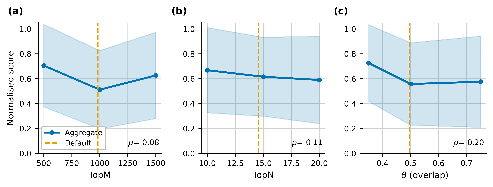 | 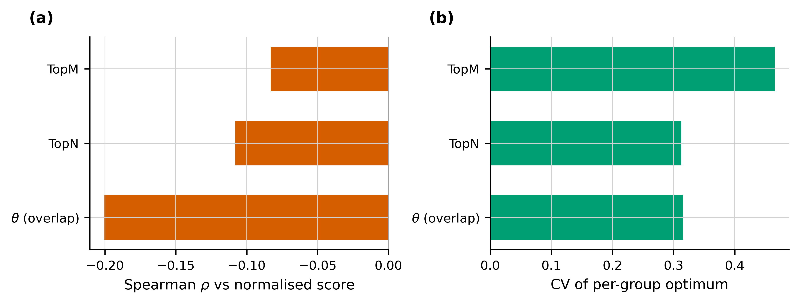 |
| Normalized score vs. each hyperparameter | (a) Spearman importance, (b) stability of the best value |
| 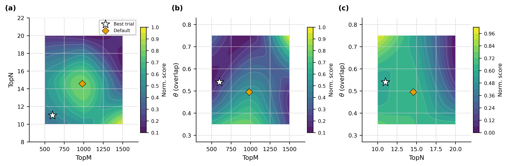 | 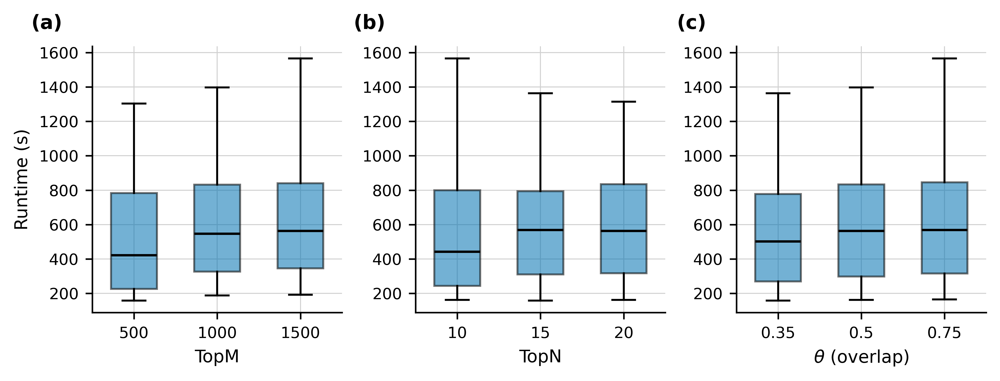 |
| Score landscape for each pair (interpolated) | Trial runtime by value |

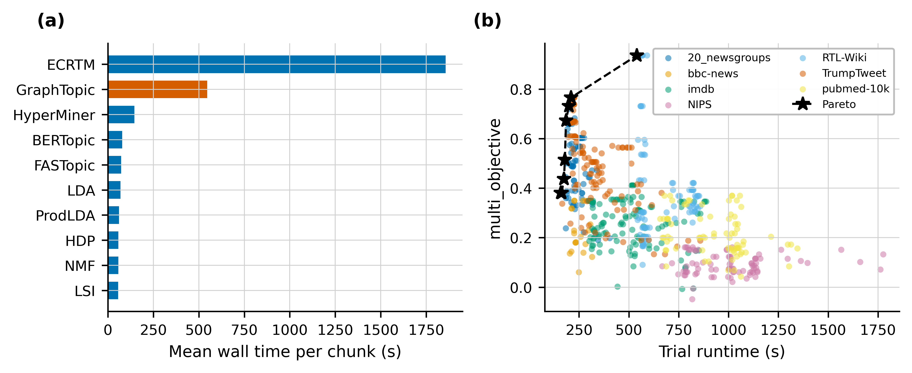

*(a) Mean wall time per chunk of every model; (b) tuning objective vs. trial runtime, with the Pareto front.*

Supplementary figures are in `results/parameter_effects/supplementary/`: violin plots of the best values, binned scores, a heatmap of the best value per dataset × chunk, effects by chunk and by dataset, the top-20% trials, per-dataset contours, and a 3-D surface. Every figure comes as `.pdf`, as a 600-dpi `.png`, and as a `.csv` of the plotted values.

## 9. Scalability analysis

**Protocol.** Each model was run on growing subsets of BBC (smallest corpus), 20NG (medium), and Trump (largest): 10%, 20%, …, 100% of the documents. That is 10 sizes × 10 models × 3 datasets = 300 runs. GraphTopic used fixed settings, `TopM=1000, TopN=10, θ=0.5, max_topics=10`, so tuning does not affect the timing. Baselines used 10 topics, 3,000 features, $n$-grams (2, 3), and 100 epochs for the neural models.

**Measures.** $N_k$ is the number of documents and $T_k$ the runtime at size $k$:

* scaling exponent $s = \dfrac{\ln(T_{end}/T_{start})}{\ln(N_{end}/N_{start})}$, where $s<1$ is sub-linear, $s=1$ linear, and $s>1$ super-linear;
* growth per doubling of the data, $g = (2^{s} - 1)\times 100\%$;
* data index $= 100\,N_k/N_1$, runtime index $= 100\,T_k/T_1$, and **normalized index** $= 100\times$ runtime index / data index. The normalized index stays at 100 for linear growth and falls below 100 for sub-linear growth.

**All models:**

| Model | BBC $s$ | 20NG $s$ | Trump $s$ | Mean $s$ | Growth per doubling $g$ | Normalized index at 100% (BBC / 20NG / Trump) |
|---|---:|---:|---:|---:|---:|---|
| LDA | 1.08 | 0.68 | 1.14 | 0.97 | 95.7% | 121 / 48 / 139 |
| NMF | 1.41 | 1.11 | 1.52 | 1.35 | 154.5% | 255 / 130 / 335 |
| HDP | 1.04 | 1.05 | 1.10 | 1.06 | 109.1% | 109 / 113 / 127 |
| LSI | 0.96 | 0.89 | 1.02 | 0.96 | 94.6% | 92 / 78 / 105 |
| ProdLDA | 0.85 | 0.93 | 1.21 | 0.99 | 99.3% | 71 / 85 / 161 |
| HyperMiner | 0.96 | 1.03 | 1.18 | 1.06 | 108.0% | 91 / 107 / 151 |
| BERTopic | 0.24 | 0.41 | 0.15 | 0.27 | 20.2% | 17 / 26 / 19 |
| ECRTM | 0.79 | 1.42 | 1.26 | 1.16 | 122.7% | 61 / 266 / 180 |
| FASTopic | 0.14 | 0.52 | 0.75 | 0.47 | 38.6% | 14 / 33 / 56 |
| **GraphTopic (proposed)** | 0.77 | 0.73 | 0.62 | 0.71 | 63.1% | 59 / 53 / 42 |

**GraphTopic in detail:**

| Dataset | Docs (10% → 100%) | Runtime (s) | $s$ overall | $s$ first half | $s$ second half | Verdict |
|---|---|---|---:|---:|---:|---|
| BBC | 222 → 2,225 | 26.6 → 156.2 | 0.77 | 0.86 | 0.46 | sub-linear |
| 20NG | 1,833 → 18,331 | 102.5 → 544.3 | 0.73 | 0.68 | 0.88 | sub-linear |
| Trump | 5,657 → 56,571 | 263.5 → 1106.1 | 0.62 | 0.32 | 1.70 | super-linear (growing faster at larger sizes) |

GraphTopic's runtime grows **sub-linearly on average** ($s = 0.71$, +63% per doubling of the data). Its normalized index ends at 42–59, the third-lowest after BERTopic and FASTopic. Two caveats:

* its **absolute** runtime is higher than that of most baselines;
* on Trump, growth is slow in the first half ($s = 0.32$) but faster than linear in the second half ($s = 1.70$). The script's verdict therefore reads "super-linear (growing faster at larger sizes)" even though the overall $s$ is 0.62.

10 of the 300 runs did not produce a result: BERTopic failed on 6 Trump sizes and 1 20NG size, and ProdLDA, HyperMiner, and ECRTM returned no topics at 40% of 20NG. The exponents use the successful runs only.

| | |
|---|---|
| 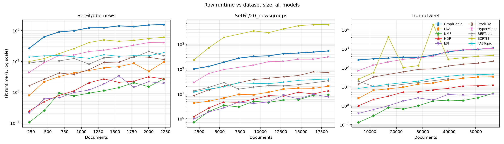 | 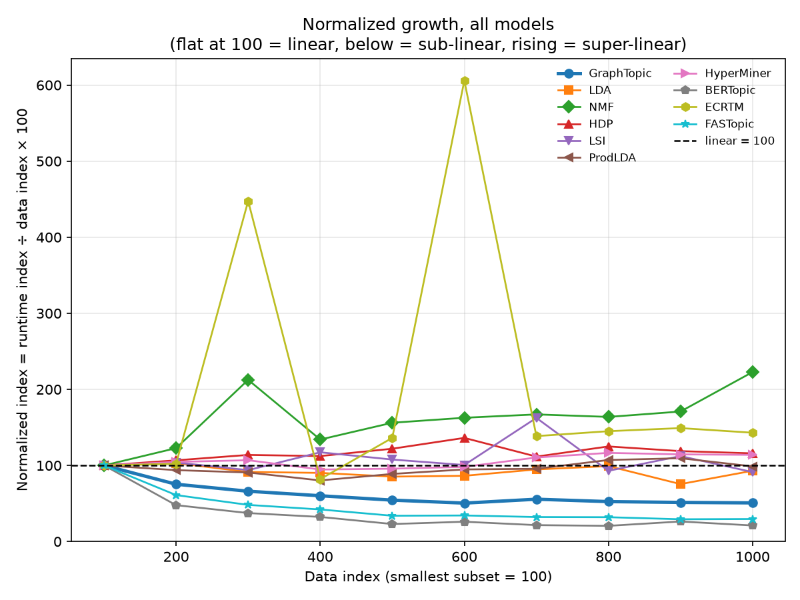 |
| Runtime vs. number of documents | Normalized index (100 = linear) |
| 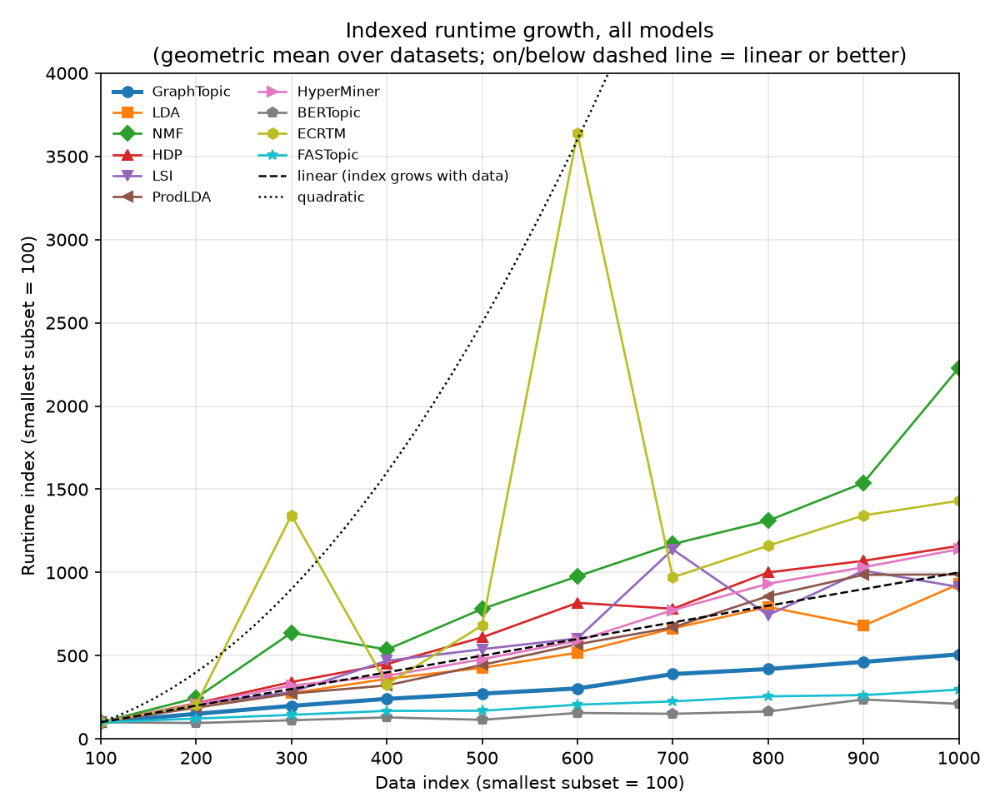 | 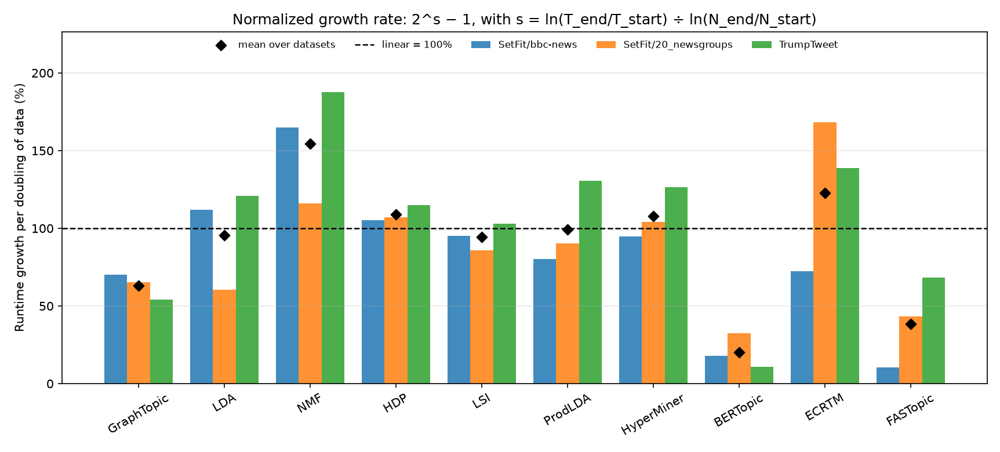 |
| Runtime index vs. data index | Growth per doubling of the data |

## 10. Projection check (1-D overlap ω)

GraphTopic decides whether to merge two subtopics from their overlap $\omega$ after projecting both onto the line through their centres. [`experiments/projection_check.py`](experiments/projection_check.py) intercepts every overlap computation in a real run and compares $\omega$ with three measures computed **before** the projection:

* `ovl_3d`: the overlap of the same Gaussians in the full 3-D PCA space;
* `cos_cent`: the cosine similarity of the 768-D centroids;
* `knn_mix`: the k-nearest-neighbour mixing in the 768-D space.

| Dataset | Pairs | Spearman($\omega$, ovl_3d) | Spearman($\omega$, cos_cent) | Spearman($\omega$, knn_mix) | Merge decisions agreeing with ovl_3d |
|---|---:|---:|---:|---:|---:|
| 20NG | 153 | 0.647 | 0.574 | 0.163 | 100.0% |
| BBC | 950 | 0.732 | 0.633 | −0.276 | 96.6% |
| Trump | 3,000 | 0.606 | 0.563 | −0.360 | 99.4% |
| **All** | 4,103 | 0.642 | 0.573 | −0.336 | 98.8% |

$\omega$ preserves the ordering of the full 3-D overlap well (ρ ≈ 0.6–0.7), and 98.8% of the merge decisions are the same. Merges are rare, though (51 of 4,103 pairs), so Cohen's κ is low (0.07 overall) and should not be over-read. Details are in `results/projection_check/summary.json` and `pairs.csv`.

| | |
|---|---|
| 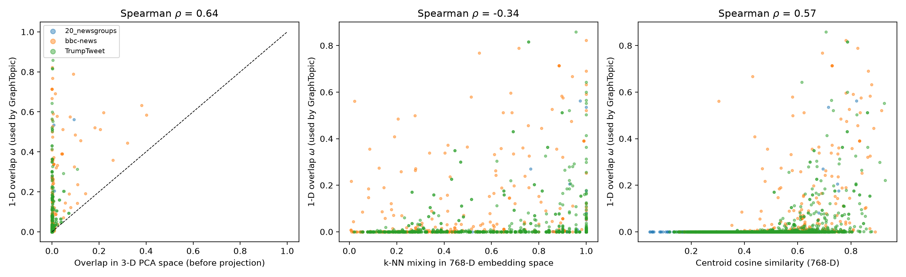 | 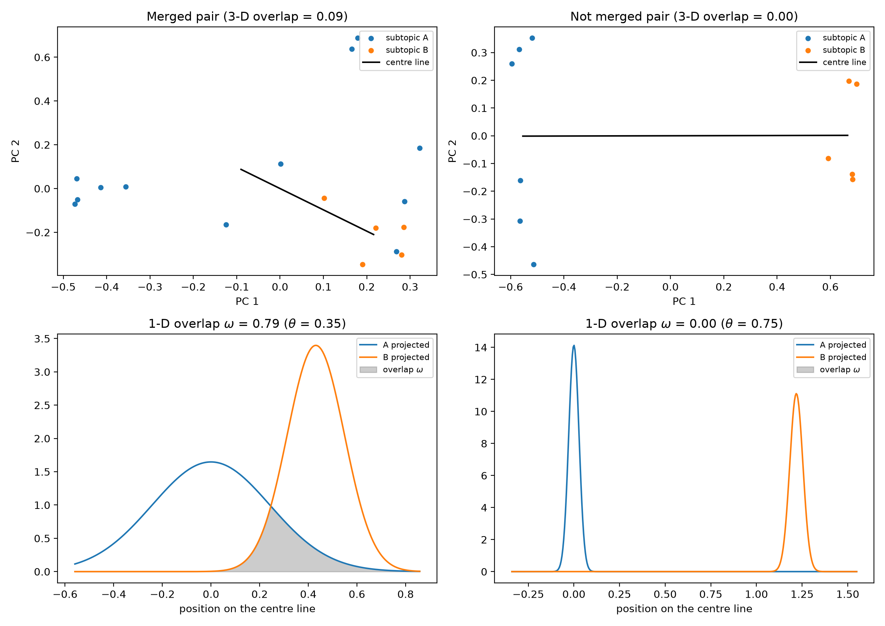 |

## 11. Limitations and notes

* **Number of topics.** GraphTopic decides the number of topics itself, up to 10. On some datasets it returns fewer: on average 2.0 on PubMed, 3.8 on RTL-Wiki, 6.6 on IMDB, and 6.8 on NIPS. HyperMiner returns 2 topics and BERTopic 9. Fewer, larger topics can raise coherence and intra-topic similarity, so compare `num_topics` in the CSVs when you interpret the scores.
* **Inter-topic distance** is the one metric on which GraphTopic is never best.
* **BERTopic** produced a non-finite $C_{NPMI}$ on some chunks; its averages use the finite chunks only (3 of 4 on 20NG, 2 of 5 on Trump).
* Coherence uses texts rebuilt from bag-of-words. This affects the sliding-window measures ($C_V$, $C_{UCI}$, $C_{NPMI}$) for all models equally (see `FIXES_NOTE.md`).
* Runtimes come from one run per chunk on a single shared machine. Peak memory is recorded in the CSVs but is noisy.
* GraphTopic is tuned per chunk while the baselines use defaults. The tuning cost is reported separately (Section 8), and the robust default $(1000, 15, 0.50)$ is provided for an untuned setting.

## 12. Contributing

Issues and pull requests are welcome. Please describe the change, and include the smoke-test output (`python experiments/full_dataset_comparison_v1.py --smoke`) when you change the experiment code.
